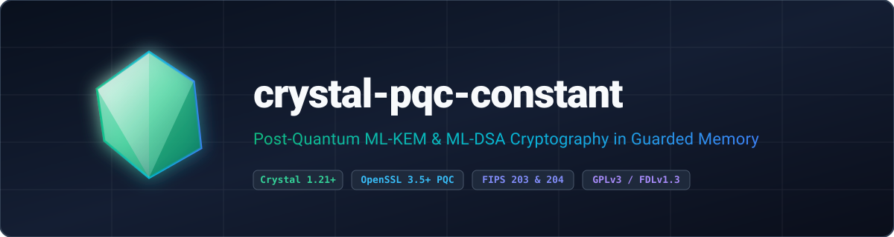

<p align="center">
  
</p>

<p align="center">
  <strong>Constant-time Post-Quantum Cryptography (NIST FIPS 203 ML-KEM and FIPS 204 ML-DSA) for Crystal backed by OpenSSL 3.5+ and libsodium guarded memory.</strong>
</p>

<p align="center">
  <a href="https://gitlab.com/renich/crystal-pqc-constant/-/releases"></a>
  <a href="https://crystal-lang.org/">= 1.21.0" /></a>
  <a href="https://gitlab.com/renich/crystal-pqc-constant/-/pipelines"></a>
  <a href="https://gitlab.com/renich/crystal-pqc-constant"></a>
  <a href="https://github.com/crystal-ameba/ameba"></a>
  <a href="https://github.com/kdairatchi/flaw"></a>
</p>

<p align="center">
  <a href="https://renich.gitlab.io/crystal-pqc-constant/"></a>
  <a href="https://renich.gitlab.io/crystal-pqc-constant/technical/api/"></a>
  <a href="LICENSE"></a>
  <a href="https://liberapay.com/Renich/donate"></a>
</p>

> **GitLab Project Metadata**:
> - **Description**: Constant-time Post-Quantum Cryptography (NIST FIPS 203 ML-KEM and FIPS 204 ML-DSA) for Crystal backed by OpenSSL 3.5+ and libsodium guarded memory.
> - **Topics and Tags**: `crystal`, `crystal-lang`, `post-quantum-cryptography`, `pqc`, `ml-kem`, `ml-dsa`, `fips-203`, `fips-204`, `openssl`, `libsodium`, `gplv3`

---

## Overview

**crystal-pqc-constant** (`Crystal::Pqc::Constant`) is a standalone, zero-dependency Crystal shard providing production-grade post-quantum key encapsulation (**NIST FIPS 203 `ML-KEM`**) and digital signatures (**NIST FIPS 204 `ML-DSA`**). It binds directly to OpenSSL 3.5+ `EVP_PKEY` providers while isolating all long-lived private keys and 32-byte shared secrets inside `libsodium` guarded heap memory (`sodium_malloc` + `sodium_mprotect_readonly`).

### Key Highlights

1. **Zero Runtime Shard Dependencies**: Links directly against system `libcrypto` (OpenSSL 3.5+) and `libsodium` with zero external Crystal shards.
2. **NIST FIPS 203 (`ML-KEM`) Key Encapsulation**: Supports `ML-KEM-512` (Category 1), `ML-KEM-768` (Category 3, default), and `ML-KEM-1024` (Category 5) with implicit-rejection decapsulation and single-use `SharedSecret#consume`.
3. **NIST FIPS 204 (`ML-DSA`) Digital Signatures**: Supports `ML-DSA-44` (Category 2), `ML-DSA-65` (Category 3, default), and `ML-DSA-87` (Category 5) detached signing and verification.
4. **Guarded Memory Isolation**: Secret keys and shared secrets are allocated in `sodium_malloc` canary-guarded pages, locked `PROT_READ` at rest via `sodium_mprotect_readonly`, synchronized with `Sync::Mutex`, and deterministically wiped via `sodium_memzero` prior to release.
5. **Multi-Tier Documentation Suite**: Complete Sphinx technical, functional (`[FUNC-001]`–`[FUNC-007]`), business, ADR, D2 visual diagrams, and compiler-generated API reference documentation.

---

## Post-Quantum Cryptography Architecture

`crystal-pqc-constant` eliminates garbage-collector retention of sensitive key material by separating public parameters from guarded private keys (`SecureBuffer`):

### NIST FIPS 203 (`ML-KEM`) Parameter Matrix

| Variant | OpenSSL Name | Public Key (B) | Secret Key (B) | Ciphertext (B) | Shared Secret (B) |
| :--- | :--- | :---: | :---: | :---: | :---: |
| `KEMVariant::MLKEM512` | `ML-KEM-512` | 800 | 1632 | 768 | 32 |
| `KEMVariant::MLKEM768` | `ML-KEM-768` | 1184 | 2400 | 1088 | 32 |
| `KEMVariant::MLKEM1024` | `ML-KEM-1024` | 1568 | 3168 | 1568 | 32 |

### NIST FIPS 204 (`ML-DSA`) Parameter Matrix

| Variant | OpenSSL Name | Public Key (B) | Secret Key (B) | Signature (B) |
| :--- | :--- | :---: | :---: | :---: |
| `DSAVariant::MLDSA44` | `ML-DSA-44` | 1312 | 2560 | 2420 |
| `DSAVariant::MLDSA65` | `ML-DSA-65` | 1952 | 4032 | 3309 |
| `DSAVariant::MLDSA87` | `ML-DSA-87` | 2592 | 4896 | 4627 |

---

## Installation

Ensure OpenSSL 3.5+ (`openssl-devel`/`openssl-dev`) and `libsodium` (`libsodium-devel`/`libsodium-dev`) are installed on your system, then add `crystal-pqc-constant` to your application's `shard.yml`:

```yaml
dependencies:
  crystal-pqc-constant:
    gitlab: renich/crystal-pqc-constant
    version: ~> 0.1.0
```

Then install the shard:

```bash
shards install
```

---

## Usage

### ML-KEM Key Encapsulation

```crystal
require "crystal-pqc-constant"

alice = Crystal::Pqc::Constant::MLKEMKeyPair.generate(
  Crystal::Pqc::Constant::KEMVariant::MLKEM768
)
begin
  enc = Crystal::Pqc::Constant::MLKEMKeyPair.encapsulate(alice.public_key)
  dec_secret = alice.decapsulate(enc[:ciphertext])

  agreed = enc[:shared_secret].consume do |sender_secret|
    dec_secret.consume do |receiver_secret|
      Crystal::Pqc::Constant::Sodium.constant_time_equal?(sender_secret, receiver_secret)
    end
  end
  puts "Shared secret agreed: #{agreed}"
ensure
  alice.dispose
end
```

### ML-DSA Digital Signatures

```crystal
require "crystal-pqc-constant"

signer = Crystal::Pqc::Constant::MLDSAKeyPair.generate(
  Crystal::Pqc::Constant::DSAVariant::MLDSA65
)
begin
  message = "FIDO2 post-quantum assertion".to_slice
  signature = signer.sign(message)
  puts "Verified: #{signer.verify(message, signature)}"
ensure
  signer.dispose
end
```

---

## Build System Targets

The repository includes a comprehensive, standard `GNUmakefile`:

| Target | Description |
| :--- | :--- |
| `make all` | Runs static analysis (`lint`) and the spec test suite (`test`) |
| `make test` | Executes the spec test suite (`crystal spec`) |
| `make lint` | Runs `crystal tool format --check`, Ameba static analysis, and Flaw SAST scanner |
| `make doc-check` | Lints all reStructuredText files using `crstlint` and `rstcheck` |
| `make check` | Aggregates `lint`, `test`, and `doc-check` |
| `make docs` | Generates Crystal API docs and builds the Sphinx `dirhtml` portal |
| `make format` | Formats Crystal source files in `src/` and `spec/` |
| `make clean` | Cleans build artifacts in `bin/` and generated documentation outputs |
| `make distclean` | Removes dependencies, cache directories, and build outputs |

---

## Documentation

Full architectural blueprints, functional specifications, and operational playbooks are maintained under [`docs/`](docs/index.rst):

| Guide | Scope & Highlights | Entry Point |
| :--- | :--- | :--- |
| **Business Context & Strategy** | Post-quantum migration problem statement, ROI goals, and user personas. | [Business Specs](docs/business/spec.rst) |
| **Functional Specifications** | Deterministic requirements `[FUNC-001]`–`[FUNC-007]` and behavioral contracts. | [Functional Specs](docs/functional/spec.rst) |
| **Technical Architecture** | Specifications `[TECH-001]`–`[TECH-007]`, D2 diagrams, and threat modeling. | [Technical Specs](docs/technical/spec.rst) |
| **Release Playbook** | SemVer, Keep a Changelog, and GPG-signed GitLab release steps. | [Release Procedure](docs/technical/specs/release-procedure.rst) |
| **Architecture Decisions (ADRs)** | Immutable logs of architectural decisions and cryptographic trade-offs. | [ADR Index](docs/adrs/index.rst) |
| **Project Roadmap** | Phased milestone tracking (`Phase 1` & `Phase 2`) and D2 dependency graphs. | [Project Roadmap](docs/project/roadmap.rst) |
| **User Guides** | Installation, usage tutorials, and PQC patterns. | [User Manual](docs/user/index.rst) |
| **Crystal API Reference** | Complete interactive type hierarchy and method signatures. | [API Reference](https://renich.gitlab.io/crystal-pqc-constant/technical/api/) |

---

## Contributing & Code of Honor

All contributions must adhere to the [Universal Code of Honor](CODE_OF_HONOR.rst) and [Contributing Guidelines](CONTRIBUTING.rst).

---

## License

- **Software**: GNU General Public License v3.0 or later ([LICENSE](LICENSE)).
- **Documentation**: GNU Free Documentation License v1.3 or later ([LICENSE-DOCS](LICENSE-DOCS)).

Copyleft &copy; 2026 Rénich Bon Ćirić &lt;renich@evalinux.com&gt;.

---

## Support & Donations

If you find this shard useful and wish to support its ongoing development, please consider donating:

<p align="center">
  <a href="https://liberapay.com/Renich/donate">
    
  </a>
</p>
