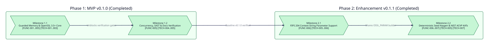

===============
Project Roadmap
===============

Executive Timeline
------------------

This master roadmap tracks the phased delivery milestones, dependency graphs, and bidirectional requirement traceability for ``crystal-pqc-constant``. Every milestone and atomic task maps deterministically to functional requirements ``[FUNC-001]`` through ``[FUNC-007]`` in :doc:`../functional/specs/core-requirements` and technical specifications ``[TECH-001]`` through ``[TECH-007]`` in :doc:`../technical/spec`.

Phase Summary Matrix
--------------------

.. list-table::
   :widths: 20 15 15 50
   :header-rows: 1

   * - Phase
     - Target Release
     - Status
     - Scope and Traceability
   * - :doc:`roadmaps/phase-1-mvp`
     - ``v0.1.0``
     - Completed
     - Core ``libsodium`` guarded memory, OpenSSL 3.5+ ``EVP_PKEY`` FFI bridge, NIST FIPS 203 ``ML-KEM``, NIST FIPS 204 ``ML-DSA``, 39 specs, zero-warning SAST, and Sphinx documentation (``[FUNC-001]``..``[FUNC-005]``, ``[TECH-001]``..``[TECH-005]``).
   * - :doc:`roadmaps/phase-2-enhancement`
     - ``v0.2.0``
     - Planned
     - NIST FIPS 204 Section 5.2 domain-separation ``context`` strings (``0..255`` bytes), deterministic seed key generation (``d||z`` and ``xi``), and NIST ACVP Known-Answer Test verification across all six parameter sets (``[FUNC-006]``, ``[FUNC-007]``, ``[TECH-005]``, ``[TECH-006]``, ``[TECH-007]``).

.. toctree::
   :maxdepth: 1
   :caption: Roadmap Phases

   roadmaps/phase-1-mvp
   roadmaps/phase-2-enhancement
   audits/index
