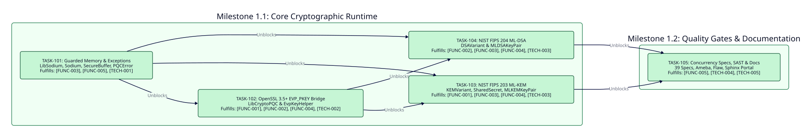

============
Phase 1: MVP
============

Timeline and Objectives
-----------------------

* **Target Release**: ``v0.1.0``
* **Status**: Completed
* **Objective**: Deliver the production-complete ``v0.1.0`` release of ``crystal-pqc-constant`` implementing NIST FIPS 203 ``ML-KEM`` and NIST FIPS 204 ``ML-DSA`` backed by OpenSSL 3.5+ ``EVP_PKEY`` providers and ``libsodium`` guarded memory.

Dependency Graph
----------------

Milestones and Atomic Tasks
---------------------------

Milestone 1.1: Core Cryptographic Runtime
~~~~~~~~~~~~~~~~~~~~~~~~~~~~~~~~~~~~~~~~~

* **TASK-101: Guarded Memory and Domain Exception Hierarchy**

  * **Status**: Completed (``[x]``)
  * **Fulfills**: ``[FUNC-003]``, ``[FUNC-005]``, ``[TECH-001]``
  * **Blocked By**: None
  * **Unblocks**: ``TASK-102``, ``TASK-103``, ``TASK-104``
  * **Deliverables**: Implement ``PQCError`` exception hierarchy in ``src/crystal-pqc-constant/errors.cr`` and ``LibSodium``, ``Sodium``, and ``SecureBuffer`` in ``src/crystal-pqc-constant/sodium.cr`` using ``sodium_malloc``, ``sodium_mprotect_readonly``, ``sodium_memzero``, and ``Sync::Mutex``.

* **TASK-102: OpenSSL 3.5+ EVP_PKEY C ABI Bridge**

  * **Status**: Completed (``[x]``)
  * **Fulfills**: ``[FUNC-001]``, ``[FUNC-002]``, ``[FUNC-004]``, ``[TECH-002]``
  * **Blocked By**: ``TASK-101``
  * **Unblocks**: ``TASK-103``, ``TASK-104``
  * **Deliverables**: Implement ``LibCryptoPQC`` C ABI bindings and ``EvpKeyHelper`` raw keypair generation, parameter extraction, and constant-time public/secret keypair consistency verification in ``src/crystal-pqc-constant/lib_crypto_pqc.cr``.

* **TASK-103: NIST FIPS 203 ML-KEM Key Encapsulation**

  * **Status**: Completed (``[x]``)
  * **Fulfills**: ``[FUNC-001]``, ``[FUNC-003]``, ``[FUNC-004]``, ``[TECH-003]``
  * **Blocked By**: ``TASK-101``, ``TASK-102``
  * **Unblocks**: ``TASK-105``
  * **Deliverables**: Implement ``KEMVariant`` (``MLKEM512``, ``MLKEM768``, ``MLKEM1024``), single-use ``SharedSecret#consume``, and ``MLKEMKeyPair`` keygen, encapsulation, and implicit-rejection decapsulation in ``src/crystal-pqc-constant/ml_kem.cr``.

* **TASK-104: NIST FIPS 204 ML-DSA Digital Signatures**

  * **Status**: Completed (``[x]``)
  * **Fulfills**: ``[FUNC-002]``, ``[FUNC-003]``, ``[FUNC-004]``, ``[TECH-003]``
  * **Blocked By**: ``TASK-101``, ``TASK-102``
  * **Unblocks**: ``TASK-105``
  * **Deliverables**: Implement ``DSAVariant`` (``MLDSA44``, ``MLDSA65``, ``MLDSA87``) and ``MLDSAKeyPair`` keygen, raw key import/validation, detached signing, and verification in ``src/crystal-pqc-constant/ml_dsa.cr``.

Milestone 1.2: Quality Gates and Documentation
~~~~~~~~~~~~~~~~~~~~~~~~~~~~~~~~~~~~~~~~~~~~~~

* **TASK-105: Concurrency Verification, SAST, and Sphinx Portal**

  * **Status**: Completed (``[x]``)
  * **Fulfills**: ``[FUNC-005]``, ``[TECH-004]``, ``[TECH-005]``
  * **Blocked By**: ``TASK-103``, ``TASK-104``
  * **Unblocks**: Phase 2 ``TASK-201``
  * **Deliverables**: Deliver 39 deterministic specs in ``spec/`` including multi-fiber concurrency stress tests, enforce zero warnings in ``ameba``, ``flaw``, ``crstlint``, and ``rstcheck``, and build the Sphinx ``dirhtml`` portal and Crystal API reference.

Critical Path
-------------

The Phase 1 critical path follows the dependency DAG where ``TASK-103`` and ``TASK-104`` execute in parallel after ``TASK-102`` and converge on ``TASK-105``:

``TASK-101 -> TASK-102 -> (TASK-103 || TASK-104) -> TASK-105``
