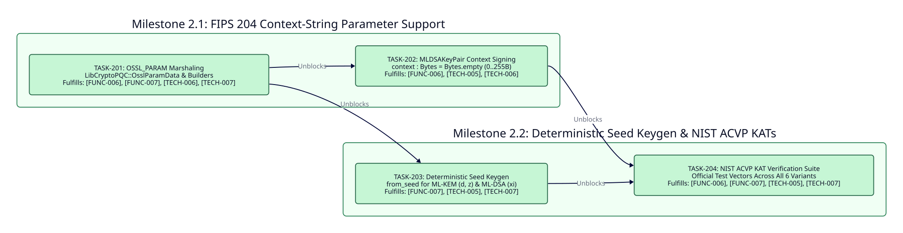

====================
Phase 2: Enhancement
====================

Timeline and Objectives
-----------------------

* **Target Release**: ``v0.2.0``
* **Status**: Planned
* **Objective**: Achieve NIST FIPS 203 and FIPS 204 specification completeness by adding FIPS 204 Section 5.2 domain-separation context strings (``0..255`` bytes), deterministic seed-based key generation (``d||z`` for ``ML-KEM`` and ``xi`` for ``ML-DSA``), and automated NIST ACVP Known-Answer Test verification across all six parameter sets (``[FUNC-006]``, ``[FUNC-007]``, ``[TECH-005]``, ``[TECH-006]``, ``[TECH-007]``).

Dependency Graph
----------------

Milestones and Atomic Tasks
---------------------------

Milestone 2.1: FIPS 204 Context-String Parameter Support
~~~~~~~~~~~~~~~~~~~~~~~~~~~~~~~~~~~~~~~~~~~~~~~~~~~~~~~~

* **TASK-201: OpenSSL 3.5+ OSSL_PARAM C ABI Marshaling**

  * **Status**: Planned (``[ ]``)
  * **Fulfills**: ``[FUNC-006]``, ``[FUNC-007]``, ``[TECH-006]``, ``[TECH-007]``
  * **Blocked By**: Phase 1 ``TASK-105``
  * **Unblocks**: ``TASK-202``, ``TASK-203``
  * **Deliverables**: Define ``LibCryptoPQC::OsslParamData`` matching OpenSSL's ``struct ossl_param_st``, bind ``EVP_PKEY_CTX_set_params``, and implement helper constructors for octet-string parameter arrays in ``src/crystal-pqc-constant/lib_crypto_pqc.cr``.

* **TASK-202: MLDSAKeyPair Context-String Signing and Verification**

  * **Status**: Planned (``[ ]``)
  * **Fulfills**: ``[FUNC-006]``, ``[TECH-005]``, ``[TECH-006]``
  * **Blocked By**: ``TASK-201``
  * **Unblocks**: ``TASK-204``
  * **Deliverables**: Extend ``MLDSAKeyPair#sign``, ``MLDSAKeyPair#verify``, and ``MLDSAKeyPair.verify`` with ``context : Bytes = Bytes.empty``, enforce ``0 <= context.size <= 255`` (raising ``SignatureError`` when ``context.size > 255``), and pass ``OSSL_SIGNATURE_PARAM_CONTEXT_STRING`` (``"context-string"``) to ``EVP_DigestSignInit_ex`` and ``EVP_DigestVerifyInit_ex``.

Milestone 2.2: Deterministic Seed Keygen and NIST ACVP KAT Verification
~~~~~~~~~~~~~~~~~~~~~~~~~~~~~~~~~~~~~~~~~~~~~~~~~~~~~~~~~~~~~~~~~~~~~~~

* **TASK-203: Deterministic Seed Key Generation for ML-KEM and ML-DSA**

  * **Status**: Planned (``[ ]``)
  * **Fulfills**: ``[FUNC-007]``, ``[TECH-005]``, ``[TECH-007]``
  * **Blocked By**: ``TASK-201``
  * **Unblocks**: ``TASK-204``
  * **Deliverables**: Implement ``MLKEMKeyPair.from_seed(seed : Bytes, variant : KEMVariant = KEMVariant::MLKEM768)`` accepting a 64-byte ``(d, z)`` seed and ``MLDSAKeyPair.from_seed(seed : Bytes, variant : DSAVariant = DSAVariant::MLDSA65)`` accepting a 32-byte ``xi`` seed via ``EVP_PKEY_keygen_init``, ``EVP_PKEY_CTX_set_params`` (``"seed"``), and ``EVP_PKEY_keygen``, storing derived secret keys in ``SecureBuffer`` and wiping intermediate buffers via ``Sodium.memzero`` in ``ensure``.

* **TASK-204: Official NIST ACVP Known-Answer Test Verification Suite**

  * **Status**: Planned (``[ ]``)
  * **Fulfills**: ``[FUNC-006]``, ``[FUNC-007]``, ``[TECH-005]``, ``[TECH-007]``
  * **Blocked By**: ``TASK-202``, ``TASK-203``
  * **Unblocks**: ``v0.2.0`` Release
  * **Deliverables**: Add ``spec/acvp_kat_spec.cr`` verifying official NIST ACVP deterministic key generation, encapsulation, decapsulation, and context-separated signature vectors across ``ML-KEM-512``, ``ML-KEM-768``, ``ML-KEM-1024``, ``ML-DSA-44``, ``ML-DSA-65``, and ``ML-DSA-87``.

Critical Path
-------------

The Phase 2 critical path follows the dependency DAG where ``TASK-202`` and ``TASK-203`` execute in parallel after ``TASK-201`` and converge on ``TASK-204``:

``TASK-201 -> (TASK-202 || TASK-203) -> TASK-204``
