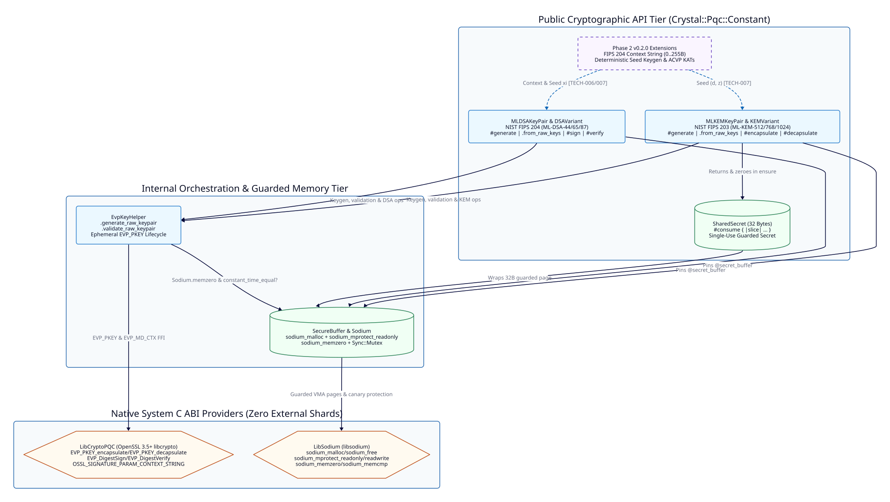

=====================
Architecture Overview
=====================

Requirement Mapping
-------------------

Fulfills ``[FUNC-001]``, ``[FUNC-002]``, ``[FUNC-003]``, ``[FUNC-004]``, ``[FUNC-005]``, ``[FUNC-006]``, and ``[FUNC-007]`` in :doc:`../../functional/specs/core-requirements`.

Component Topology
------------------

Library Layout and Namespaces
-----------------------------

The library source is organized under the ``Crystal::Pqc::Constant`` namespace across eight focused compilation units:

* ``src/crystal-pqc-constant.cr``: Root shard entrypoint requiring all internal submodules.
* ``src/crystal-pqc-constant/version.cr``: Semantic version constant ``VERSION = "0.1.1"``.
* ``src/crystal-pqc-constant/errors.cr``: Domain exception hierarchy rooted at ``PQCError`` (``DisposedError``, ``InvalidKeyError``, ``EncapsulationError``, ``SignatureError``).
* ``src/crystal-pqc-constant/sodium.cr``: ``LibSodium`` C ABI bindings, ``Sodium`` constant-time helpers, and ``SecureBuffer`` guarded heap management (``[TECH-001]``).
* ``src/crystal-pqc-constant/lib_crypto_pqc.cr``: OpenSSL 3.5+ ``EVP_PKEY``, ``EVP_MD_CTX``, and ``OSSL_PARAM`` C ABI bindings (``[TECH-002]``, ``[TECH-006]``, ``[TECH-007]``).
* ``src/crystal-pqc-constant/evp_key_helper.cr``: ``EvpKeyHelper`` key generation, deterministic seed key generation, and raw keypair consistency validation (``[TECH-002]``, ``[TECH-006]``, ``[TECH-007]``).
* ``src/crystal-pqc-constant/ml_kem.cr``: ``KEMVariant``, ``SharedSecret``, and ``MLKEMKeyPair`` implementing NIST FIPS 203 (``[TECH-003]``, ``[TECH-007]``).
* ``src/crystal-pqc-constant/ml_dsa.cr``: ``DSAVariant`` and ``MLDSAKeyPair`` implementing NIST FIPS 204 (``[TECH-003]``, ``[TECH-006]``, ``[TECH-007]``).

Technical Specifications
------------------------

[TECH-001] Guarded Memory Allocator and Synchronization
~~~~~~~~~~~~~~~~~~~~~~~~~~~~~~~~~~~~~~~~~~~~~~~~~~~~~~~

Fulfills ``[FUNC-003]`` and ``[FUNC-005]``.

``Crystal::Pqc::Constant::LibSodium`` binds directly to system ``libsodium`` functions ``sodium_init``, ``sodium_malloc``, ``sodium_free``, ``sodium_mprotect_readonly``, ``sodium_mprotect_readwrite``, ``sodium_memzero``, and ``sodium_memcmp``:

* ``Sodium.init`` synchronizes one-time library initialization using ``@@init_mutex = Sync::Mutex.new`` and ``@@initialized = Atomic(Bool).new(false)``.
* ``SecureBuffer`` allocates a canary-guarded page via ``sodium_malloc``, copies the secret slice into the allocation, and transitions page permissions to ``PROT_READ`` via ``sodium_mprotect_readonly``. If ``sodium_mprotect_readonly`` returns a non-zero status, ``SecureBuffer`` immediately zeroes and frees the page before raising ``PQCError``.
* ``SecureBuffer#with_slice`` acquires ``@mutex : Sync::Mutex``, verifies that ``@disposed`` is ``false`` and ``@ptr`` is non-null, and yields ``Bytes.new(@ptr, @size, read_only: true)``.
* ``SecureBuffer#dispose`` acquires ``@mutex``, restores ``PROT_READ | PROT_WRITE`` via ``sodium_mprotect_readwrite``, zeroes the region via ``sodium_memzero``, frees the page via ``sodium_free``, and sets ``@ptr = Pointer(UInt8).null`` and ``@disposed = true``.

[TECH-002] OpenSSL 3.5+ EVP_PKEY C ABI Bridge
~~~~~~~~~~~~~~~~~~~~~~~~~~~~~~~~~~~~~~~~~~~~~

Fulfills ``[FUNC-001]``, ``[FUNC-002]``, and ``[FUNC-004]``.

``Crystal::Pqc::Constant::LibCryptoPQC`` binds to OpenSSL 3.5+ ``libcrypto`` provider APIs without intermediate C wrappers:

* ``EvpKeyHelper.generate_raw_keypair`` creates a key generation context via ``EVP_PKEY_CTX_new_from_name(nil, algorithm, nil)``, initializes key generation via ``EVP_PKEY_keygen_init``, generates the ``EVP_PKEY`` handle via ``EVP_PKEY_keygen``, extracts the raw ``"pub"`` and ``"priv"`` octet strings via ``EVP_PKEY_get_octet_string_param``, yields them to the caller, zeroes the temporary ``priv`` buffer via ``Sodium.memzero`` in an inner ``ensure`` block, and frees the ``EVP_PKEY`` handle via ``EVP_PKEY_free`` in an outer ``ensure`` block.
* ``EvpKeyHelper.validate_raw_keypair`` enforces exact public and secret byte lengths, validates that ``EVP_PKEY_new_raw_public_key_ex`` and ``EVP_PKEY_new_raw_private_key_ex`` succeed, extracts the public key parameter ``"pub"`` from the private ``EVP_PKEY``, and verifies ``Sodium.constant_time_equal?(derived_pub, public_key)`` before freeing both handles.

[TECH-003] Ephemeral Key Reconstruction for ML-KEM and ML-DSA
~~~~~~~~~~~~~~~~~~~~~~~~~~~~~~~~~~~~~~~~~~~~~~~~~~~~~~~~~~~~~

Fulfills ``[FUNC-001]``, ``[FUNC-002]``, ``[FUNC-003]``, and ``[FUNC-004]``.

Neither ``MLKEMKeyPair`` nor ``MLDSAKeyPair`` retains a persistent ``EVP_PKEY`` pointer in memory:

* During ``MLKEMKeyPair#decapsulate`` and ``MLDSAKeyPair#sign``, the keypair enters ``@secret_buffer.with_slice``, reconstructs an ephemeral ``EVP_PKEY`` handle from the read-only guarded slice via ``EvpKeyHelper.load_private_key``, executes ``EVP_PKEY_decapsulate`` or ``EVP_DigestSign``, and frees the ``EVP_PKEY`` handle in ``ensure`` before releasing the ``SecureBuffer`` mutex.
* ``MLKEMKeyPair.perform_encapsulation`` and ``MLKEMKeyPair.perform_decapsulation`` allocate a temporary 32-byte stack/heap slice ``ss``, wrap it in ``SharedSecret.new(ss)`` (which copies it into a dedicated ``SecureBuffer``), and zero ``ss`` via ``Sodium.memzero(ss)`` in ``ensure``.

[TECH-006] OpenSSL OSSL_PARAM Context-String Marshaling
~~~~~~~~~~~~~~~~~~~~~~~~~~~~~~~~~~~~~~~~~~~~~~~~~~~~~~~

Fulfills ``[FUNC-006]`` (Delivered in Phase 2 ``v0.1.1``).

To support NIST FIPS 204 Section 5.2 domain-separation context strings:

* ``LibCryptoPQC`` defines the C ABI ``OsslParamData`` struct matching OpenSSL's ``struct ossl_param_st`` (``key : LibC::Char*``, ``data_type : LibC::UInt``, ``data : Void*``, ``data_size : LibC::SizeT``, ``return_size : LibC::SizeT``) alongside ``OSSL_PARAM_OCTET_STRING = 5_u32``.
* ``MLDSAKeyPair#sign``, ``MLDSAKeyPair#verify``, and ``MLDSAKeyPair.verify`` validate ``context.size <= 255`` (raising ``SignatureError`` when exceeded) and construct a two-element null-terminated ``StaticArray(LibCryptoPQC::OsslParamData, 2)`` via ``EvpKeyHelper.build_octet_param_array`` setting key ``"context-string"`` to ``context`` when passing ``params`` into ``EVP_DigestSignInit_ex`` and ``EVP_DigestVerifyInit_ex``.

[TECH-007] Deterministic Seed Keygen and NIST ACVP KAT Harness
~~~~~~~~~~~~~~~~~~~~~~~~~~~~~~~~~~~~~~~~~~~~~~~~~~~~~~~~~~~~~~

Fulfills ``[FUNC-007]`` (Delivered in Phase 2 ``v0.1.1``).

To support deterministic key generation from FIPS 203 ``(d, z)`` and FIPS 204 ``xi`` seeds and NIST ACVP Known-Answer Tests:

* ``EvpKeyHelper.generate_raw_keypair_from_seed`` initializes the key generation context via ``EVP_PKEY_keygen_init``, passes an ``OSSL_PARAM`` octet-string parameter with key ``"seed"`` (``OSSL_PKEY_PARAM_ML_KEM_SEED`` for ``ML-KEM`` and ``OSSL_PKEY_PARAM_ML_DSA_SEED`` for ``ML-DSA``) into ``EVP_PKEY_CTX_set_params``, executes ``EVP_PKEY_keygen``, extracts the resulting ``"pub"`` and ``"priv"`` parameters into guarded memory, and wipes all intermediate seed and key buffers via ``Sodium.memzero`` in ``ensure``.
* ``spec/acvp_kat_spec.cr`` verifies deterministic seed-derived keypair generation (``pub_sha256`` and ``sec_sha256`` Known-Answer Test digests) alongside hedged encapsulation/decapsulation and context-bound signature roundtrips across all six parameter sets (``ML-KEM-512``, ``ML-KEM-768``, ``ML-KEM-1024``, ``ML-DSA-44``, ``ML-DSA-65``, and ``ML-DSA-87``).
